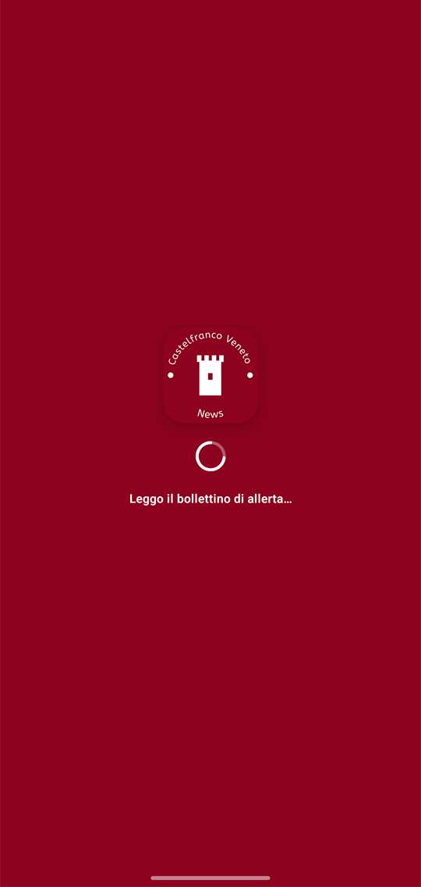
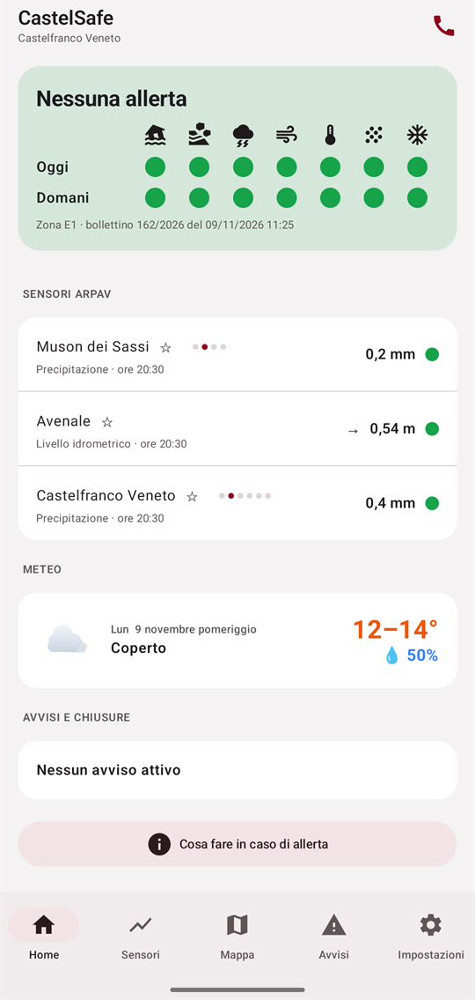
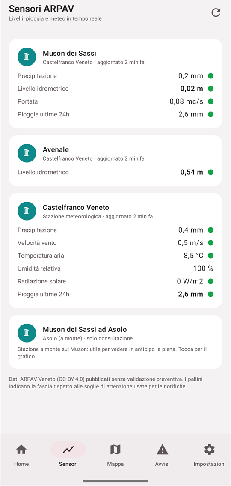
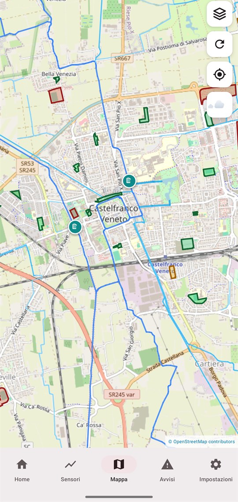
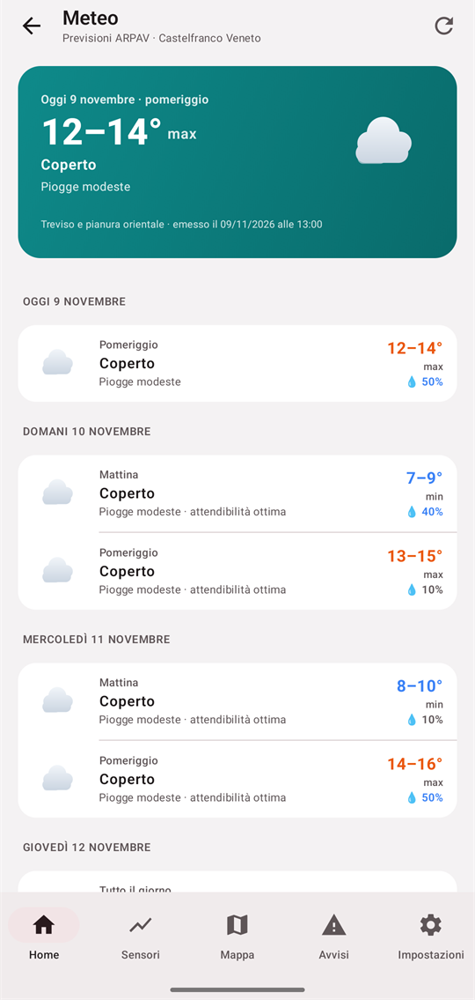
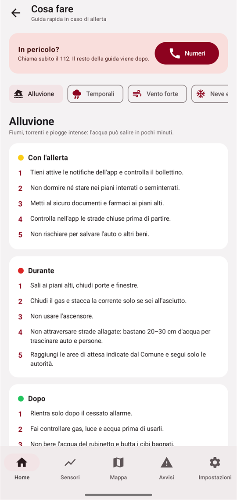
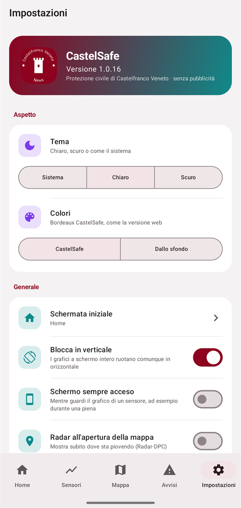

<div align="center">

# CastelSafe per Android

**L'app nativa per restare informati su allerte, fiumi e chiusure di Castelfranco Veneto.**

[](https://github.com/newscastelfrancoveneto-lab/CastelSafe-APK/releases/latest)
[](https://github.com/newscastelfrancoveneto-lab/CastelSafe-APK/actions/workflows/build.yml)


[**Scarica l'APK**](https://github.com/newscastelfrancoveneto-lab/CastelSafe-APK/releases/latest) · [Versione web](https://newscastelfrancoveneto-lab.github.io/CastelSafe/) · [Repo della versione web](https://github.com/newscastelfrancoveneto-lab/CastelSafe)

</div>

---

CastelSafe riunisce in un'unica app le informazioni di protezione civile per i cittadini di Castelfranco Veneto: il bollettino di allerta regionale, i livelli dei corsi d'acqua, le piogge, il radar e le strade chiuse. Questa è la versione nativa per Android della [web app](https://newscastelfrancoveneto-lab.github.io/CastelSafe/): più veloce, con widget sulla Home e notifiche che puoi regolare nel dettaglio.

<div align="center">

| Avvio | Home | Sensori | Mappa |
|:---:|:---:|:---:|:---:|
|  |  |  |  |

| Meteo | Cosa fare | Impostazioni |
|:---:|:---:|:---:|
|  |  |  |

</div>

## Cosa offre

### Allerta a colpo d'occhio
La Home mostra lo stato dell'allerta regionale per la zona **E1**, oggi e domani, su sette rischi: idraulico, idrogeologico, temporali, vento, ondate di calore, neve e ghiaccio al suolo. Sotto, i sensori delle tue stazioni preferite, con la **freccia di tendenza** dell'ultima ora (sale, scende, stabile) e un avviso quando un dato sale in fretta.

### Sensori ARPAV
Livelli idrometrici, portata, pioggia (anche cumulata sulle 24 ore), vento, temperatura, umidità e radiazione solare, con grafici e soglie di attenzione. Le stazioni che segui stanno in cima alla lista.

### Mappa, radar e meteo
Mappa OpenStreetMap con strade chiuse, divieti, aree di protezione civile e corsi d'acqua. Radar delle precipitazioni e previsioni del tempo. Il pulsante *Naviga* apre l'app di navigazione che preferisci.

### Notifiche che decidi tu
Per ogni tipo di notifica (allerta, sensori, avvisi, comunicazioni) e per ogni livello scegli come essere avvisato:

| Modo | Cosa succede |
|---|---|
| **Nessuna** | Non ricevi nulla |
| **Silenziosa** | Compare solo nella tendina |
| **Con suono** | Suono e vibrazione |
| **Allarme** | Sirena anche con il telefono in silenzioso, fino a quando la fermi |

Puoi impostare le **ore di quiete** e far suonare l'allarme solo di notte. L'app ti avvisa anche se i dati dei sensori smettono di aggiornarsi o se il server non risponde.

### Widget
Allerta, sensori, grafico di un sensore e radar direttamente sulla Home del telefono, con le letture che scegli tu.

### Cosa fare in caso di allerta
Una guida pratica per ogni rischio (alluvione, temporali, vento forte, neve e ghiaccio, caldo, terremoto, rischio industriale) con le azioni da fare prima, durante e dopo e il kit di emergenza. Al primo avvio, una breve introduzione spiega le funzioni principali; puoi rivederla da *Impostazioni*.

### Su misura
Tema chiaro, scuro o dai colori dello sfondo, scheda di avvio a scelta, schermo sempre acceso durante la consultazione di un grafico e controllo automatico degli aggiornamenti.

## Installazione

1. Dal telefono apri la pagina delle **[release](https://github.com/newscastelfrancoveneto-lab/CastelSafe-APK/releases/latest)** e scarica il file `CastelSafe-X.Y.Z.apk`.
2. Aprilo. Android ti chiederà di consentire l'installazione da questa origine: è normale, l'app non è pubblicata sul Play Store.
3. Al primo avvio, consenti le **notifiche** (Android 13 e successivi).

**Requisiti:** Android 8.0 o successivo.

**Aggiornamenti.** L'app controlla da sola le nuove versioni su questa pagina e te le propone.

> **Notifiche che arrivano in ritardo?** Alcuni produttori (Oppo, Xiaomi, Huawei e altri) chiudono le app in background per risparmiare batteria. Per ricevere le allerte in tempo, escludi CastelSafe dall'ottimizzazione della batteria nelle impostazioni del telefono.

## Privacy

- Nessun servizio Google né tracciamento pubblicitario.
- Le impostazioni e i filtri delle notifiche restano **sul tuo telefono**.
- Le statistiche d'uso sono anonime (un identificativo casuale, nessun dato personale) e si disattivano da *Impostazioni*.
- La posizione è facoltativa: viene chiesta solo se tocchi *La mia posizione* sulla mappa e serve solo a mostrarti sulla mappa, sul telefono.

## Da dove arrivano i dati

| Dato | Fonte |
|---|---|
| Bollettino di allerta | Regione del Veneto, Protezione Civile |
| Livelli, portate, piogge, vento, temperatura | ARPAV (licenza [CC BY 4.0](https://creativecommons.org/licenses/by/4.0/deed.it)) |
| Previsioni meteo | ARPAV |
| Radar delle precipitazioni | Dipartimento della Protezione Civile |
| Cartografia | © contributori di [OpenStreetMap](https://www.openstreetmap.org/copyright) |
| Chiusure e avvisi | Segnalazioni inserite dagli amministratori |

> I dati ARPAV sono pubblicati senza validazione preventiva e possono essere corretti in un secondo momento.

## Per chi sviluppa

**Stack.** Kotlin e Jetpack Compose (Material 3), Navigation Compose, OkHttp, kotlinx.serialization, WorkManager per i controlli in background, Glance per i widget, osmdroid per la mappa. Nessuna dipendenza da Google Play Services.

**Struttura.**

```
app/src/main/java/io/github/andreadp271/castelsafe/
├── data/     modelli, accesso ai dati, notifiche, tendenze, aggiornamenti
├── ui/       schermate (Home, Sensori, Mappa, Radar, Notifiche, Impostazioni)
└── widget/   widget della Home
```

**Compilare.** Servono JDK 17 e l'Android SDK.

```bash
./gradlew assembleDebug      # APK di prova in app/build/outputs/apk/debug/
```

Le versioni firmate di rilascio si producono con una chiave riservata che non fa parte della repo: dalla copia locale si compila solo la versione di prova. Per i dati e le notifiche in tempo reale serve il servizio CastelSafe, che non fa parte di questa repo.

**Pubblicare una versione.**

1. Aumenta `versionCode` e `versionName` in `app/build.gradle.kts` e scrivi le note in `fastlane/metadata/android/it-IT/changelogs/<versionCode>.txt`.
2. Esegui `git tag vX.Y.Z && git push --tags`: un workflow compila e firma l'APK e lo pubblica come release `CastelSafe-X.Y.Z.apk`.

La chiave di firma non deve mai cambiare: con una chiave diversa gli aggiornamenti non si installano sopra la versione esistente.

## Avvertenza

CastelSafe è uno strumento informativo e **non sostituisce i canali ufficiali** né il giudizio sul posto. In caso di pericolo immediato chiama il **112**.

## Segnalazioni

Un errore o un'idea? Apri una [segnalazione](https://github.com/newscastelfrancoveneto-lab/CastelSafe-APK/issues). Per un problema di sicurezza non usare le issue pubbliche: contatta direttamente i gestori del progetto.

---

<div align="center">
<sub>Progetto civico per Castelfranco Veneto · Dati ARPAV Veneto (CC BY 4.0) · © contributori di OpenStreetMap</sub>
</div>
